# Carlink (`jbr1.carlinkit`)

Fork of [lvalen91/carlink](https://github.com/lvalen91/carlink) configured for Google Play
under the package name **`jbr1.carlinkit`**.

Upstream is a native Kotlin CarPlay / Android Auto projection app for the
[Carlinkit CPC200-CCPA](https://www.carlinkit.com/ccpa) adapter. This fork changes Play-facing
identity so it does not collide with the original `zeno.carlink` listing:

| Identity | This fork | Upstream |
|---|---|---|
| `applicationId` / Play package | `jbr1.carlinkit` | `zeno.carlink` |
| Play cluster-icon authority | `jbr1.carlinkit.ClusterIconContentProvider` | GM Templates Host authority (owner-only) |
| Album-art FileProvider | `jbr1.carlinkit.albumart` | `zeno.carlink.albumart` |
| CarAppActivity taskAffinity | `jbr1.carlinkit.templates` | `zeno.carlink.templates` |
| AltVideo IPC service | `jbr1.carlinkit.ipc.NaviVideoSourceService` | `zeno.carlink.ipc.NaviVideoSourceService` |

Sign release / Play builds with **your own** upload keystore (never reuse upstream keys).

## Requirements

- AAOS 10 (Android 10) or higher
- [Carlinkit CPC200-CCPA](https://www.carlinkit.com/ccpa) adapter on firmware 2025.10

## Build the Play Console AAB

```bash
./gradlew bundlePlayRelease
```

Output (default Gradle build dir may be under `~/.cache/gradle-builds` per `gradle.properties`;
override with `-Pcarlink.buildRoot=./build-out` if you want artifacts in-tree):

```bash
./gradlew bundlePlayRelease -Pcarlink.buildRoot=./build-out
# → build-out/.../play/release/*.aab
```

Optional release signing via environment variables (also used by CI):

- `CARLINK_KEYSTORE_FILE`
- `CARLINK_KEYSTORE_PASSWORD`
- `CARLINK_KEY_ALIAS`
- `CARLINK_KEY_PASSWORD`

Without those env vars, release builds still succeed but stay **unsigned** — sign locally or
in CI before uploading to Play.

### Publish on Play (GM / no ADB)

1. Create an app in [Google Play Console](https://play.google.com/console/) with package
   **`jbr1.carlinkit`**.
2. Upload the `play` release AAB to an **Internal Testing** track.
3. Add your Google account as a tester, accept the opt-in link, install from Play **on the
   head unit** while signed into that account.

### Sideload APK (ADB platforms)

```bash
./gradlew assembleSideloadRelease -Pcarlink.buildRoot=./build-out
adb install -i com.android.vending path/to/app-sideload-release.apk
```

The `-i com.android.vending` flag records Play as the installer so AAOS honors distraction
optimization. The sideload flavor claims the GM cluster-icon authority (useful on-device;
do **not** upload that APK to Play). On GM production radios without ADB, prefer the Play
app + HUD icon bridge below — a fully sideloaded UI is covered when leaving Park.

## HUD / cluster turn icons (Play fork workaround)

Play locks the reserved Templates Host authority
`com.google.android.apps.automotive.templates.host.ClusterIconContentProvider` to upstream
`zeno.carlink` ([issue #6](https://github.com/lvalen91/carlink/issues/6)). A Play-only
`jbr1.carlinkit` install therefore gets **text nav without turn glyphs** on gminfo3.7.

**Fix:** keep the display app on Play, and sideload a tiny companion that owns the reserved
authority:

```bash
./gradlew :app:bundlePlayRelease -Pcarlink.buildRoot=./build-out
./gradlew -p iconbridge assembleRelease -Pcarlink.buildRoot=./build-out
# Play  ← …/play/release/*.aab          (jbr1.carlinkit)
# USB   ← …/iconbridge/release/*.apk    (jbr1.carlinkit.hudicons)
```

`iconbridge/` is a nested standalone Gradle project (not part of the Android Studio
multi-module sync) so the main app imports cleanly.

1. Uninstall any other app that already claims that GM authority.
2. Install Carlink from Play, then sideload the iconbridge APK while parked.
3. Relaunch Carlink; look for
   `[NAVI_ICON] Cluster icon provider available via jbr1.carlinkit.hudicons`.

Details: [documents/reference/hud-icon-bridge.md](documents/reference/hud-icon-bridge.md).
Does not apply on GM VCU radios (enum-only cluster glyphs).

## Key limitations

Full explanations in **[app notes](documents/reference/app-notes.md)**:

- **Cluster song metadata** can go blank after force-stop + relaunch — an AOSP limitation
  with no third-party fix. All other cases are fixed.
  [Details](documents/reference/app-notes.md#cluster-song-metadata-can-go-blank)
- **Navigation turn-by-turn** is basic on stock adapter firmware; the
  [custom firmware](#custom-adapter-firmware) restores full iAP2 route data, and the app
  renders CarPlay maneuver icons on-device.
  [Details](documents/reference/app-notes.md#navigation-turn-by-turn)
- **Cluster navigation icons** on gminfo3.7 need the reserved GM authority — use the
  sideloaded `:iconbridge` companion with a Play install (see above).
  [Details](documents/reference/app-notes.md#cluster-navigation-icons-gminfo37-only--for-forks--other-developers)
- **GM VCU (Bosch VCUNH1)** vehicles ignore app-supplied cluster icons entirely.
  [Details](documents/reference/app-notes.md#gm-vcu-platform-bosch-vcunh1)
- **HUD** is untested (author's truck has none); some Silverado/Hummer EV users report nav shows.
  [Details](documents/reference/app-notes.md#heads-up-display-hud)
- **"Not Supported" USB toast on GM AAOS 14+** — GM's USB admission code only recognizes a
  fixed set of device types; the adapter's working mode isn't one of them, which is why the
  old Carlinkit UDisk toggle was a workaround.
  [Details](documents/reference/app-notes.md#not-supported-usb-toast-on-gm-aaos-14)

## Custom adapter firmware

Optional. Adapter-side binaries were patched to (1) forward the full iAP2 navigation data
Carlinkit otherwise strips, and (2) fix Android Auto's incorrect parsing of forwarded vehicle
GPS NMEA. Not required, but gives a closer-to-stock experience. Firmware lives in
[CPC200-CCPA_resources](https://github.com/lvalen91/CPC200-CCPA_resources).
See [notes](documents/reference/app-notes.md#custom-adapter-firmware).

## Audio

If audio misbehaves, first disconnect and forget the phone/vehicle from each other's
Bluetooth and grant the app microphone access — the adapter routes audio through itself by
default. Steering-wheel voice/call control is a system feature this app can't provide; for it,
set in-app adapter routing to Bluetooth instead. See
[audio routing](documents/reference/app-notes.md#audio-routing--troubleshooting).

## Screenshots

From the Android emulator with USB passthrough for the CPC200-CCPA.

| CarPlay (iPhone) | Android Auto (Pixel 10) | Dashboard |
|---|---|---|
| 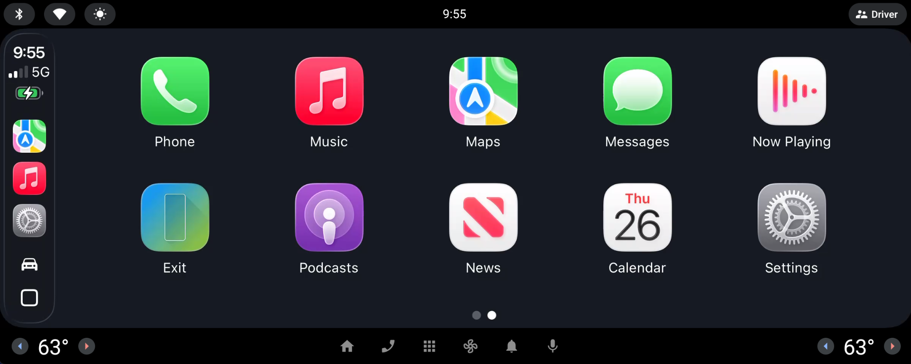 | 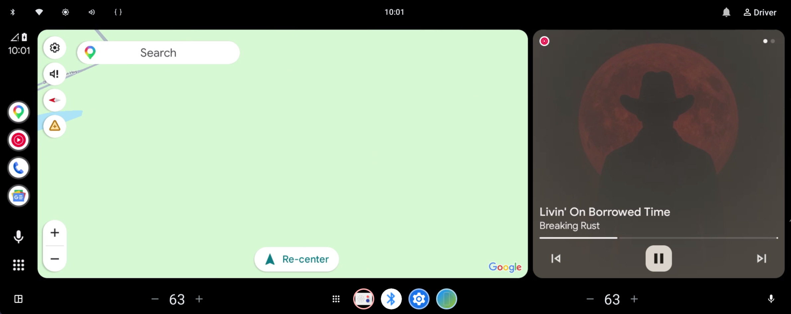 | 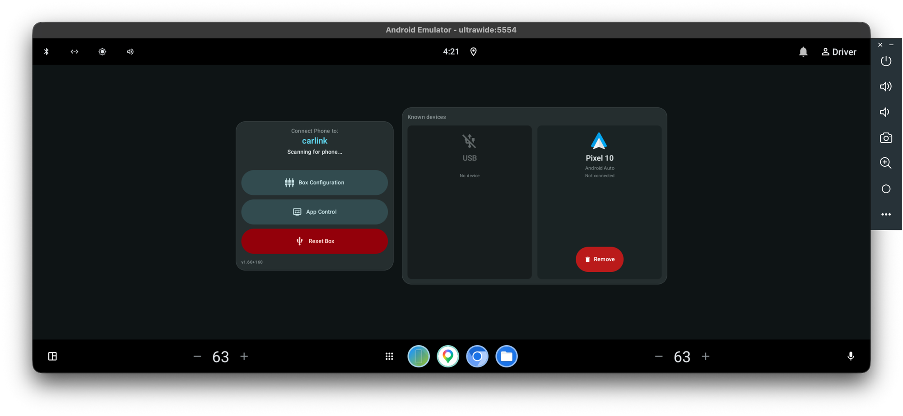 |

**Dashboard** — the app's always-visible base screen; shows the box's advertised name and
live connection phase, and sits behind the video while a session is streaming:

| Idle, no phone connected | Over an active Android Auto session |
|---|---|
|  | 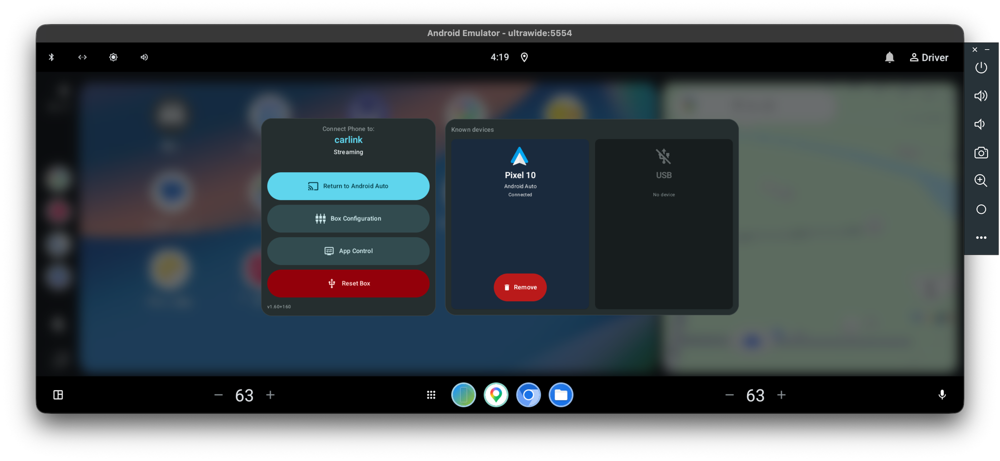 |

**CarPlay dark mode** — the app tells the box to switch CarPlay's own UI dark automatically,
independent of the app's (always-dark) rendering:

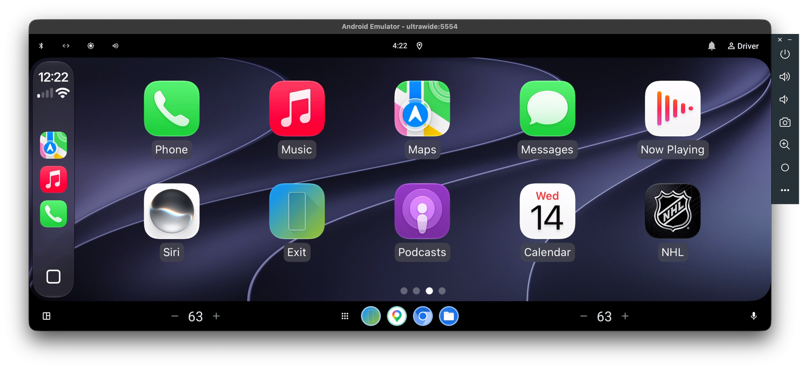

**Adapter configuration** — applied on reboot via *Apply & Restart*:

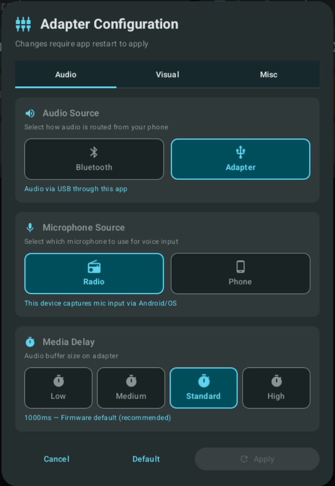
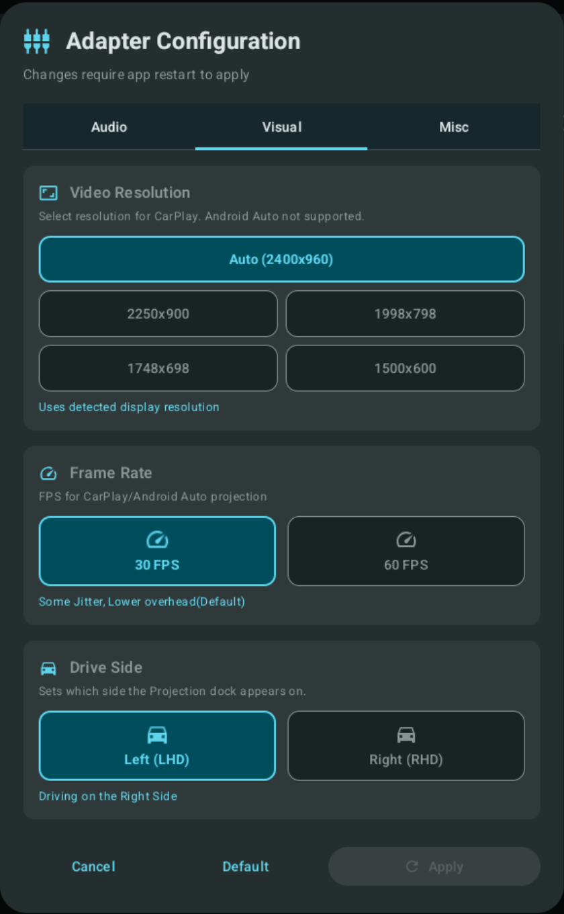
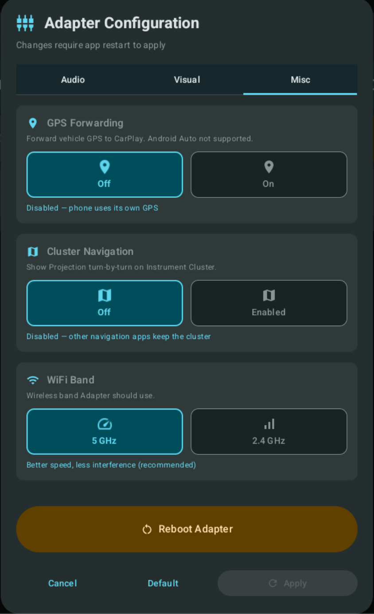

**App settings** — control what is hidden/shown to give the projection stream more room:

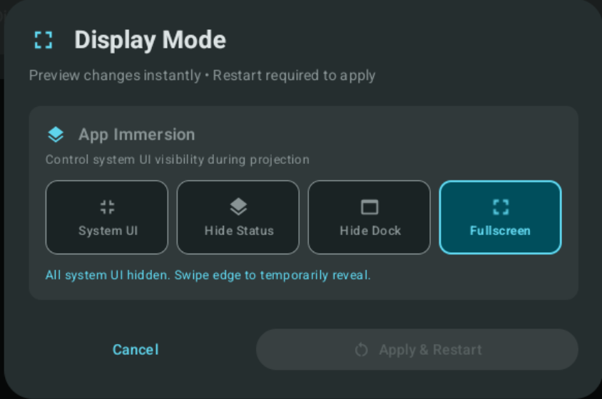

**Log export & levels** — export logs to a file via the Android documents picker (no extra
folder permissions needed; can save to attached USB, subject to OS restrictions). Multiple
log levels narrow troubleshooting to the area you need:

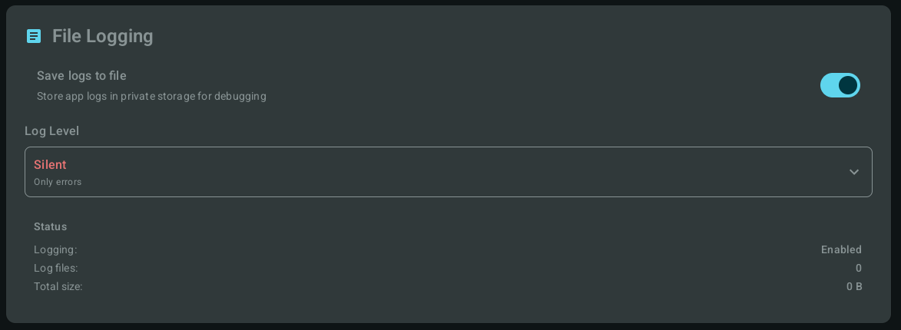
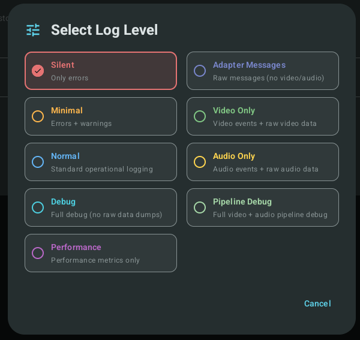

## Documentation

The app is **self-contained** — this repo builds and runs on its own. The docs in this repo
are the primary reference:

| Topic | Where | What it is |
|---|---|---|
| App behavior, limitations & design notes | [documents/reference/app-notes.md](documents/reference/app-notes.md) | The detail behind this README |
| Reference docs index | [documents/reference/](documents/reference/) | Emulator, cluster, and platform notes |

Accuracy isn't guaranteed, but it's the most detailed, centralized source short of the
adapter/GM source itself. If you have direct adapter/GM-radio source, there's a site that
will gladly publish it anonymously.

## Supporting & reference material

Separate repos — **not dependencies of this app** — that back the research behind it or
provide background:

| Repo | What it is |
|---|---|
| [CPC200-CCPA_resources](https://github.com/lvalen91/CPC200-CCPA_resources) | Work on the Carlinkit CPC200-CCPA adapter (firmware, reverse engineering) |
| [gminfo_resources](https://github.com/lvalen91/gminfo_resources) | GM head-unit / gminfo3.7 AAOS platform reference |
| [carlink_flutter](https://github.com/lvalen91/carlink_flutter) | The original Flutter app this one reimplements |
| [XDA Forums thread](https://xdaforums.com/t/carlink.4774308/) | Discussion and support; report issues here or on GitHub |

## Credits

Projects that started this and provided insight, inspiration, and a lot of help:

- [carplay by abuharsky](https://github.com/abuharsky/carplay) — original Android implementation
- [node-CarPlay by rhysmorgan134](https://github.com/rhysmorgan134/node-CarPlay) — protocol reverse engineering
- [LIVI by f-io](https://github.com/f-io/LIVI) — Linux (Raspberry Pi) and macOS implementation
- [pycarplay by electric-monk](https://github.com/electric-monk/pycarplay) — Python implementation
